# Bubble-project-documentation-G7

Group Number: 7  
Team Members: Lucie Mallard-Gonder, Rohan Oruganti, Yuying Chen

## Contents

1. [Overall Concept](#overall-concept)
   - [Why These Inputs and Outputs](#why-these-inputs-and-outputs)
   - [User Journey](#user-journey)
2. [System Overview](#system-overview)
3. [Mechanical Design](#mechanical-design)
4. [Hardware Design](#hardware-design)
5. [Assembly Guide](#assembly-guide)
6. [Software](#software)
7. [Machine Learning](#machine-learning)
8. [Debugging Guide](#debugging-guide)
9. [Reflection and Future Work](#reflection-and-future-work)
10. [References and Acknowledgements](#references-and-acknowledgements)

All images are in [`images/`](images/).

## Overall Concept
Bubble is a desktop companion that keeps you company while you work. It notices you, reacts to you, and offers a little encouragement, support and entertainment.

Our starting point was Rocky from Project Hail Mary: a character with no face, whose feelings you read entirely from how he moves. Bubble has no face either. Everything it feels, it expresses through posture, movement and timing. A big part of the project was exploring how much emotion a body alone can communicate.

## System Overview

### Why These Inputs and Outputs

We chose inputs that people already use every day to communicate without words: nodding, shaking your head, waving and smiling. They need no explanation or training to use, so anyone who sits down in front of Bubble can interact with it straight away, including people trying it for the first time.

Bubble answers in the same language. It replies to body language with body language, the way a person or a pet would. Smiling on its own doesn't make Bubble move; instead, it changes the meaning of a wave. A happy wave and a reluctant wave get very different responses, which makes the interaction feel personal rather than mechanical.

### User Journey

| You... | Bubble... | What it communicates |
| --- | --- | --- |
| **Nod** | Nods back | Agreement: "I'm with you" |
| **Shake your head** | Turns its head from side to side | Sympathy: "no, me neither" |
| **Wave while smiling** | Does a happy little kick, then waves back quickly and fluidly | Excitement at seeing you |
| **Wave without smiling** | Lowers its head in disappointment, then gives one slow, bouncing wave | A reluctant, sad goodbye |

## System Overview

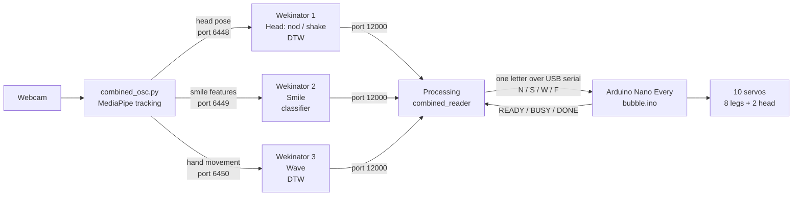

### Input

A webcam watches the person sitting at the desk. A Python script, `combined_osc.py`, uses **MediaPipe** to track three things at once and sends each to its own Wekinator project:

- **Head:** the head's pitch and yaw (tilting up and down, turning left and right).
- **Smile:** the left and right mouth-smile measurements from the face.
- **Hand:** the hand's movement and tilt.

The script also sends a "tracking status" signal for each, so the rest of the system knows when it can trust the data, for example when a face or hand has gone out of view.

### Machine Learning

Three Wekinator models run in parallel:

| Model | Type | Detects |
| --- | --- | --- |
| 1. Head | Dynamic time warping (DTW) | A **nod** or a **head shake** |
| 2. Smile | Classifier | **Smiling** or **straight-faced** |
| 3. Wave | Dynamic time warping (DTW) | A **hand wave** |

DTW suits nods, shakes and waves because they're movements over time rather than held poses. A classifier suits smiling, which is a state at a single moment.

Full details of the training data and evaluation are in [Machine Learning](#machine-learning).

### Messaging

All three Wekinator models send their results to one **Processing** sketch on port 12000, which decides what the robot should do:

- **Nod** or **shake** → sends **N** or **S**.
- **Wave** → Processing checks the person's expression over the next 0.6 seconds. If at least 80% of the smile predictions agree, it sends **W** (smiling) or **F** (not smiling). If the result is unclear, it does nothing rather than guess.

Processing only accepts a gesture when tracking is stable and the robot is free. It sends **one letter** over USB serial, and the Arduino replies:

- **BUSY** when it starts the movement
- **DONE** when it finishes

If the Arduino doesn't reply in time, Processing goes into a safe **fault** state instead of sending more commands. Pressing **r** recovers it.

### Output

The Arduino Nano Every runs `bubble.ino`, which turns each letter into a movement of the 10 servos: 8 in the legs and 2 in the head.

It uses the **ServoEasing** library, so the servos speed up and slow down along curves (linear, bounce, and so on) instead of moving at one fixed speed. We used different curves to give each response its own character, for example a quick, fluid linear wave for happy, and a bounce for the reluctant wave.

**Power:** the servos are powered from the power board,

## Mechanical Design

Bubble Robot is a small four-legged companion that reacts to people with its body and a nodding, tilting and turning head.

We built it on the open-source Sesame quadruped. Sesame can walk and pose, but it has no head; its face is a flat screen. Our goal was a robot whose reactions read clearly across a table. So we added a moving physical head and wrapped the whole robot in a soft, rounded "bubble" body, and we did both without giving up any leg motion.

### What we improved

| | Original Sesame | Bubble Robot |
| --- | --- | --- |
| Servos | 8 (legs) | 10 (8 legs + 2 head) |
| Head | Flat face screen, no head motion | Physical head that nods, tilts and turns |
| Head turn | – | Driven by the L1 hip through a lever; no extra servo; self-centring |
| Leg range | Full | Full: hips keep their original range, knees still turn 180° |
| Body | Open printed frame, servos exposed | Closed rounded shell, cut away around every joint |
| Parts | 3D-printed parts, M2 screws | 3D-printed parts, standard bearings, steel push rods, M2/M3 screws |

### Base Design

We started from the open-source [Sesame robot](https://github.com/dorianborian/sesame-robot) by Dorian Todd. Sesame is a small quadruped with two SG90 servos per leg:

- a **hip servo**, which swings the leg forwards and backwards;
- a **knee servo**, which lifts the foot.

We chose Sesame because its legs already give a stable, posable base that is cheap to print and runs on SG90s. That let us spend our time on the head and the body. We kept its leg layout, servo pockets and joint geometry, and changed everything above the legs.

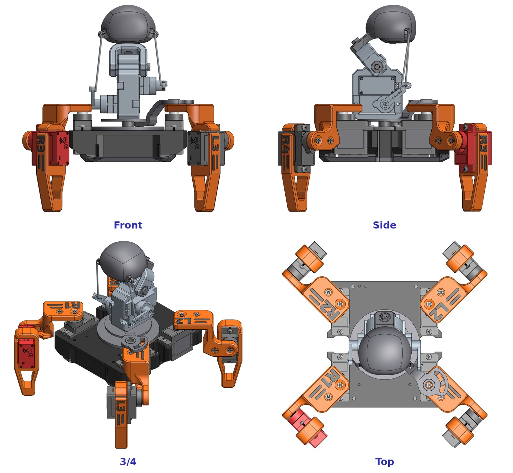

### Modifications

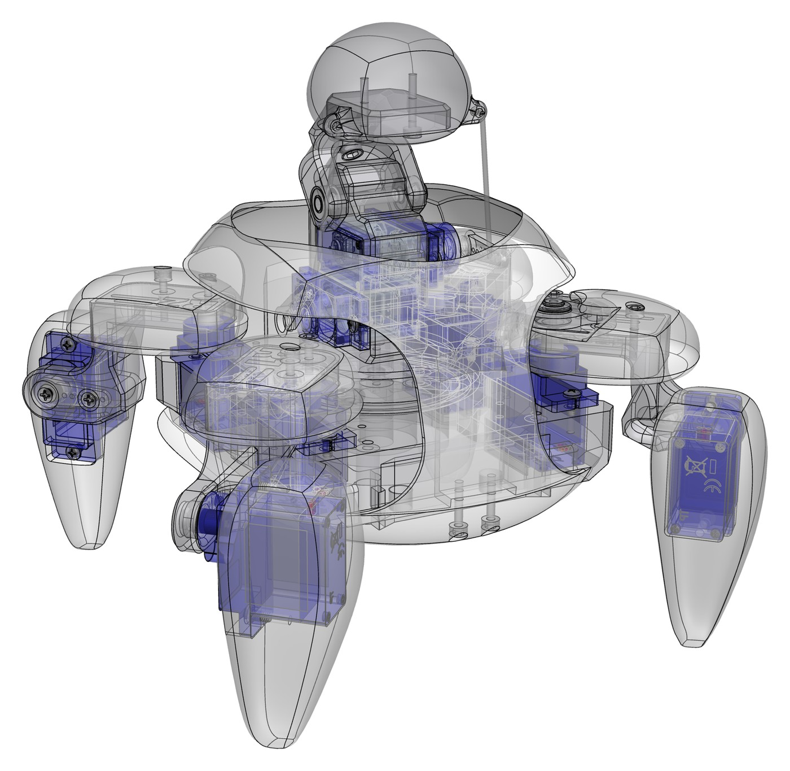

Every change we made to Sesame, and why we made it.

#### 1. Head sunk into a wider body

**What:** We removed Sesame's screen top and widened the body base. We moved the four hip servos outwards and cut a round opening in the centre for the turntable's bearing hub.

**Why:**
- We wanted Bubble to express emotion and personality without a face. So we removed the screen and let a physical head carry the expression through its posture and movement.
- We widened the base so the head can turn on a turntable inside the body. The legs are unchanged.

#### 2. A 2-servo head that nods and tilts

**What:** Two SG90s sit in a servo hub under the head. They drive it through two steel push rods (see *How the Joints Work*).

**Why:**
- The servos stay low and out of sight, and the head itself carries no motors, so it stays small and light.
- We set the lower servo horn at about 40°, to keep both servos away from their end stops.
- Before printing, we checked every pose in a custom servo simulator. The head stays at least 1.6 mm clear of the frame and servos, and the push rods stay 4.6 mm clear of the head.

#### 3. Head turning driven by the L1 hip

**What:** The head unit stands on a turntable. A lever on the L1 hip turns it, and a rubber band brings it back to centre.

**Why:** Turning the head needs no 11th servo. The lever only engages beyond L1's normal range, so the leg can still walk and pose freely.

#### 4. A rounded "bubble" body

**What:** We gave the whole robot a rounded, bubble-like look:
- a rounded top shell and bottom case;
- femur caps over each hip;
- teardrop foot shells over the knees;
- a round head.

**Why:** It gives the soft, cute and friendly character of our concept, and makes the head and body read as one creature. The shell is shaped around the space each servo needs at its motion limits, so it never limits the hips, knees or head.

<details>
<summary><b>Design process: how we got to the final shell and head</b></summary>

1. **First version: fully rounded shells.** We wrapped every part in smooth domes, including a dome over the head. We rejected it for two reasons:
   - The shells blocked the servos' motion.
   - The dome over the head hid the head mechanism, so its movements no longer read clearly.

   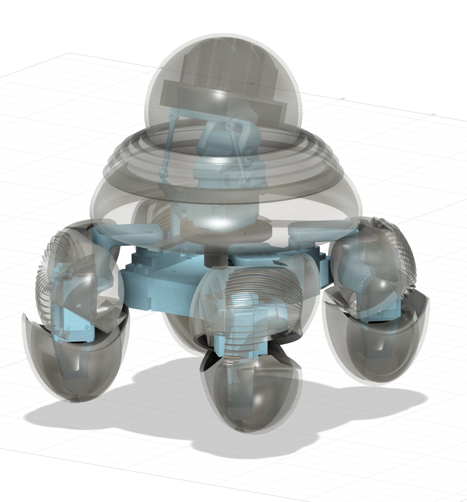

2. **Mapping the motion.** We went back to sketching. On the Sesame body, we mapped the space each servo sweeps through at its motion limits. That gave us the volumes the shell must leave free.

   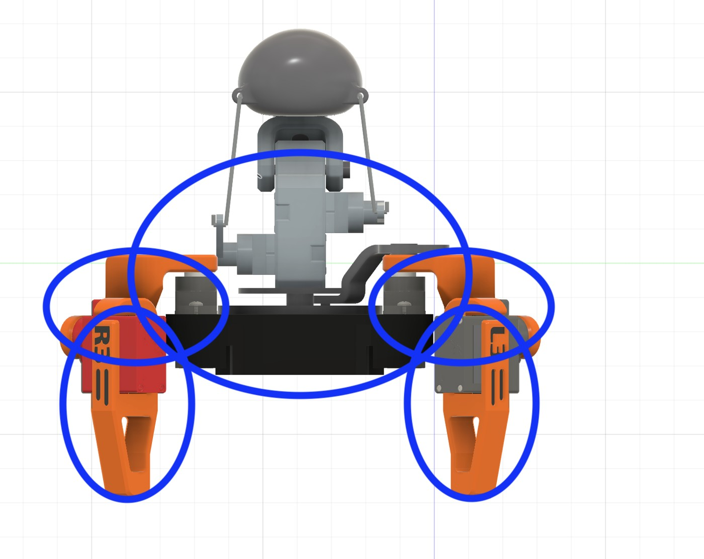

3. **Final shell and head.** We designed the final shell around those clearance volumes, so it never limits the hips or knees. For the head, we kept the original head joint and added a round shell above and below it (the head case top and bottom). This keeps the full head motion and makes the head look cohesive with the body.

   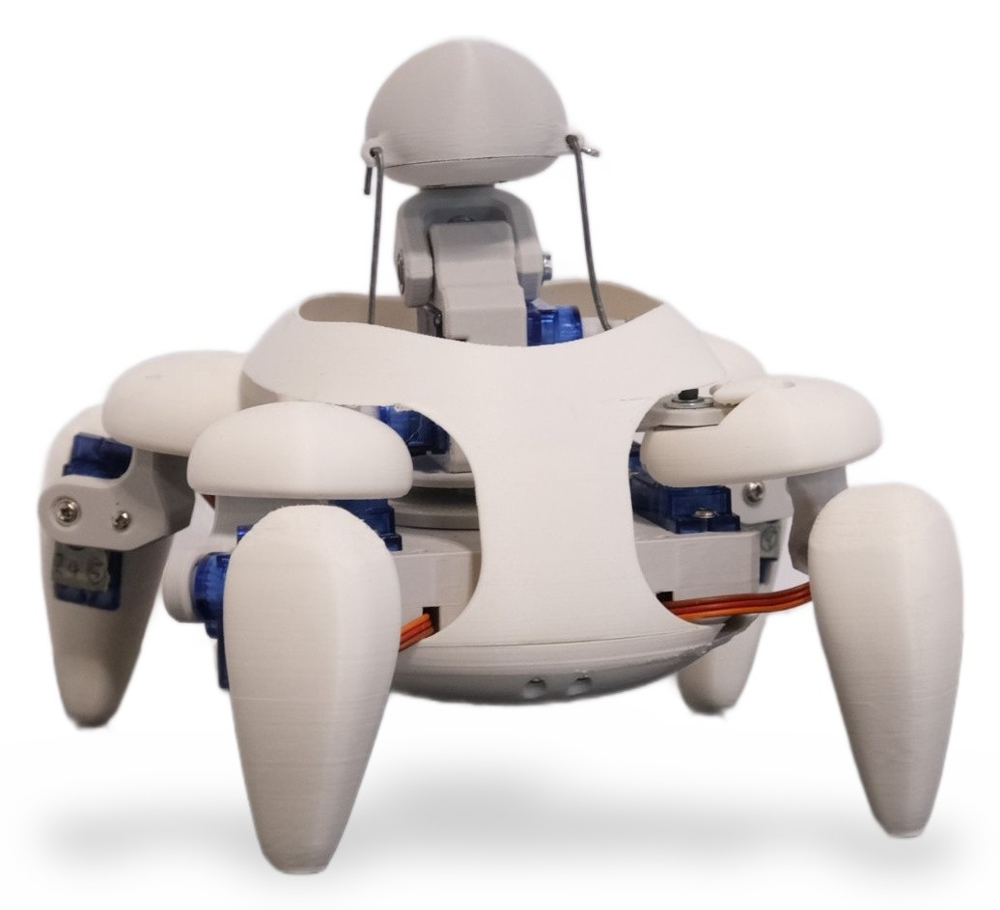

</details>

### How the Joints Work

#### Turntable (head turning)

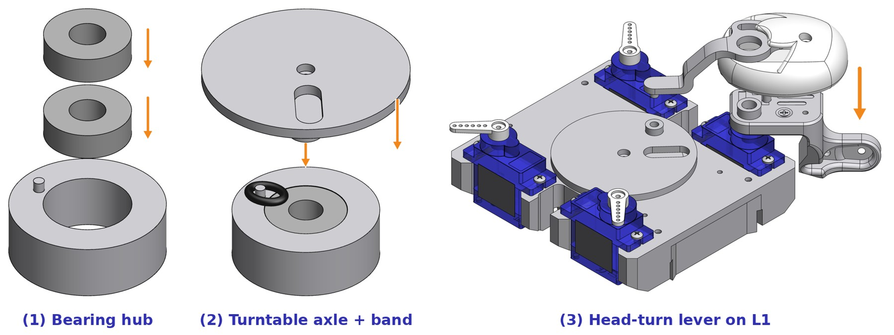

- **Bearing Hub (1):** Sits in the centre opening of the body base and holds two 619/8-2Z bearings, so the turntable spins with almost no friction.
- **Turntable Axle (2):** Its shaft runs in the bearings. The disc on top carries the head unit and has a slot for the lever. A rubber band loops over the pin on the hub and is trapped under the disc. It acts as a return spring that pulls the turntable back to centre.
- **Head-turn Lever (3):** Fixed under the L1 femur cap, so it swings with the L1 hip. An MR63 bearing on its peg runs in the slot in the disc. The hip and the turntable turn about different centres, so the slot lets the peg slide in and out as the two arcs meet, and the motion never jams.

How the head turn works:

1. While L1 moves within its normal walking and posing range, the leg moves freely.
2. When L1 swings beyond that range, the lever pushes the disc and the head turns with the leg.
3. When the leg comes back into its free range, the rubber band pulls the head back to centre on its own.

This way the head turns only on purpose, and no servo is needed to bring it back.

#### Head (nod and tilt)

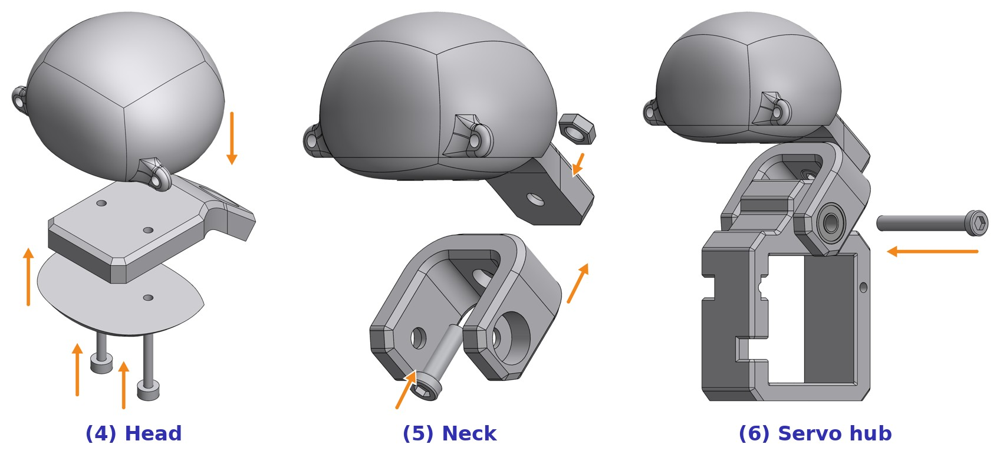

- **Head (4):** The head case top, head joint and head case bottom are bolted together with two M2×12 bolts. Two side lugs take the top ends of the push rods.
- **Neck (5):** The head swivels on the neck about an axis tilted 40° from vertical. It runs on a 639ZZ bearing, held by an M3×10 bolt and nut.
- **Servo Hub (6):** Holds both head servos and is bolted to the turntable. The neck pivots on it about a horizontal axis: an M3×25 bolt through two 639ZZ bearings. This is the nod axis.
- **Push Rods:** Bent from Ø1.2 mm steel wire. Each rod links one servo horn to one side of the head. The left rod is 48.6 mm and the right rod 44.6 mm, measured along the wire.

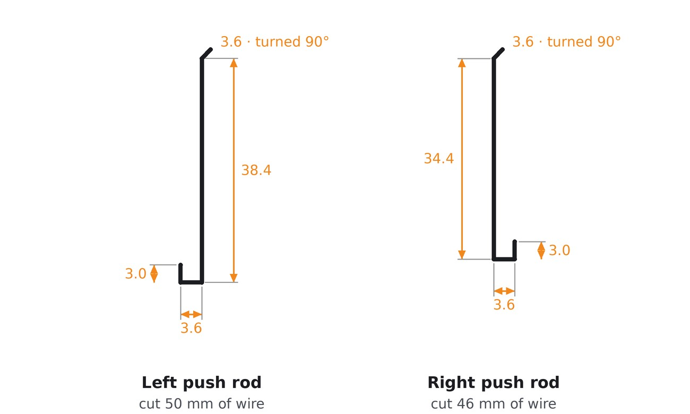

The two head servos work as a pair:

- When they turn in **opposite directions**, one side of the head is pulled down and the other pushed up, so the head **nods**: about ±22° for ±35° of servo travel.
- When they turn in the **same direction**, the head **tilts** sideways about the 40° neck axis: about +16° / −24°.
- Mixing the two gives in-between poses.

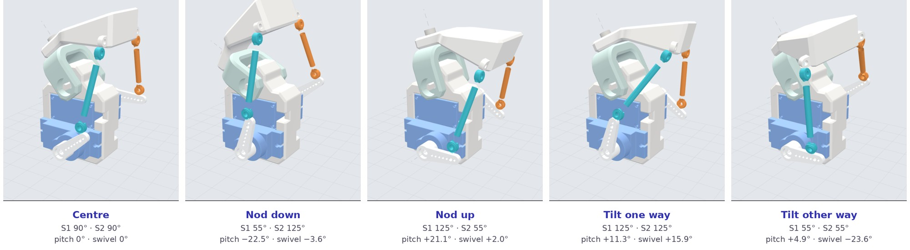

S1 is the upper head servo (HU) and S2 the lower one (HL). Both are at 90° in the centre pose.

#### Legs


- **Femur Joint (7):** Screws onto the hip servo horn and carries the knee servo. Each one has its leg name (L1, L2, R1, R2) embossed on top, so legs cannot be mixed up.
- **Femur Cap (8):** Covers the top of the hip joint and gives it the round look. On L1 it also holds the head-turn lever.
- **Foot Shell (9):** Holds the knee servo inside. Its tapered tip is the only part touching the ground.

### Materials and Fabrication

- **Printed parts:** All custom parts are FDM 3D printed in PLA: white for the body and shell, grey for the head mechanism.
  - Settings: 2 wall loops, 5–10% infill, supports on.
  - The low infill keeps the robot light for the SG90s, and the two walls keep the screw bosses strong.
- **Bearings:** We used off-the-shelf bearings at every rotating joint that carries load :
  - 2 × 619/8-2Z for the turntable;
  - 3 × 639ZZ for the nod and swivel axes;
  - 1 × MR63 for the lever peg.
- **Push rods:** Ø1.2 mm steel wire, bent by hand from a 1:1 template. Steel is stiff enough not to buckle, yet thin enough to hook straight through the servo horn and the head lugs.
- **Fasteners:** M2 screws for servos and printed parts; M3 bolts on the head pivots.
- **Assembly:** The step-by-step construction is in the [Assembly Guide](Build%20resource/Bubble%20Robot%20Assembly%20Guide.pdf). The STL files for every printed part are in [`Build resource/Printing parts`](Build%20resource/Printing%20parts).

### Key Poses

Every movement the robot plays is built from a few poses, set as servo angles in [`bubble_movements.h`](software/arduino/bubble/bubble_movements.h). Servo names follow the leg labels: L1, L2, R1 and R2 are the hips; L3, L4, R3 and R4 are the knees; HU and HL are the upper and lower head servos.

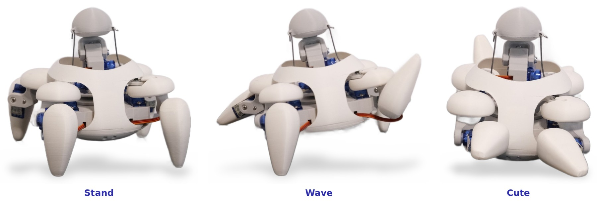

| Pose | Servo angles (°) | What happens |
| --- | --- | --- |
| **Stand** (home) | Hips R1 135, R2 45, L1 45, L2 135 · Knees R3 180, R4 0, L3 0, L4 180 | All four legs straight down. Every gesture starts and ends here. |
| **Nod** | Head rest: HU 70, HL 120. Then 4 times: HU 120 / HL 60 ↔ HU 60 / HL 120 | The two head servos swing in opposite directions, so the head nods "yes". |
| **Shake** | L1 sweeps 45 → 0 → 135 → 0 → 45 | L1 swings past its free range, so the lever turns the head left and right ("no"). The rubber band re-centres it. |
| **Cute** | Hips L1 0, R1 180, L2 160, R2 20 · Knees L3 180, R3 0, R4 180, L4 0. Then 3 times: R4 165 / L4 90 ↔ R4 90 / L4 15 | The legs fold out and two knees wiggle, like a happy little dance. |
| **Wave** | R4 80, L3 150, L2 70, R1 100 shift the weight. Then L3 waves 180 ↔ 100, twice | The robot leans onto three legs and waves the L3 leg. |
| **Disappointed** | Head HU 90 → 12 → 180, then HL 90 → 0 | The head drops down and away. Reset: HU 90, then HL 90. |

These poses are combined into the four movements the robot reacts with:

- **N** → Nod
- **S** → Shake
- **W** → Cute, then Wave
- **F** → Disappointed, then Wave

The Machine Learning section explains which interaction triggers each one.

## Hardware Design

### Wiring


### Schematic

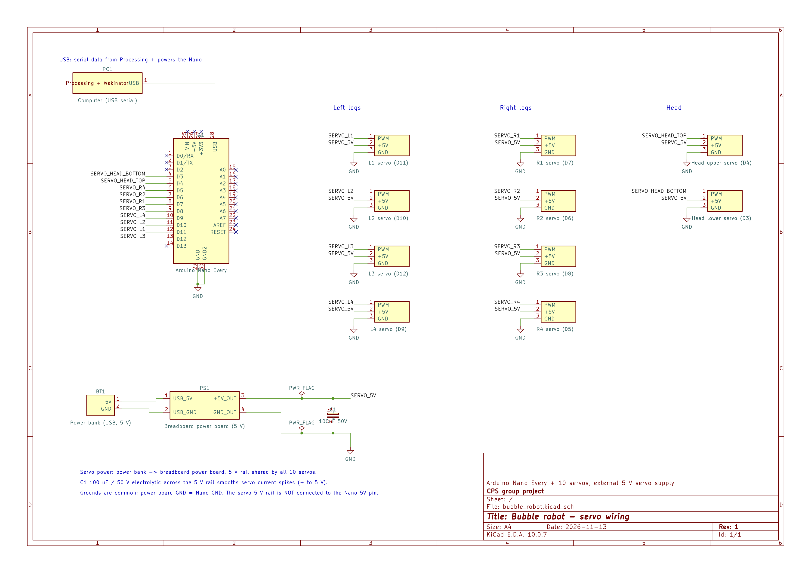


| Servo | Joint | Arduino Nano Every pin |
|---|---|---|
| S1 | L1 | D11 |
| S2 | L2 | D10 |
| S3 | L3 | D12 |
| S4 | L4 | D9 |
| S5 | R1 | D7 |
| S6 | R2 | D6 |
| S7 | R3 | D8 |
| S8 | R4 | D5 |
| S9 | Head, upper servo | D4 |
| S10 | Head, lower servo | D3 |

**Power**
- All 10 servos run from a 5 V rail: power bank → breadboard power board → servo red wires.
- C1 (100 µF / 50 V electrolytic) sits across the 5 V rail and GND to smooth the current spikes when servos start moving (+ leg to 5 V).
- The Nano Every is powered by the computer over USB; the same USB link carries the serial commands from Processing (Wekinator → Processing → Arduino).
- The servo 5 V rail is **not** connected to the Nano's 5V pin. The grounds **are** connected (power board GND ↔ Nano GND), otherwise the servo signals have no reference.

## Assembly Guide

The step-by-step build is in [Bubble Robot Assembly Guide.pdf](Build%20resource/Bubble%20Robot%20Assembly%20Guide.pdf).

Everything you need to build it is in [`Build resource/`](Build%20resource/):

- the STL files for every printed part in [`Printing parts/`](Build%20resource/Printing%20parts/);
- the full CAD model, [`Bubble_robot_CAD.step`](Build%20resource/Bubble_robot_CAD.step);
- the bill of materials, [`Bubble robot-BoM.xlsx`](Build%20resource/Bubble%20robot-BoM.xlsx).

## Software

How a webcam gesture becomes a robot movement:

```
webcam -> combined_osc.py -> 3 Wekinator projects -> combined_reader (Processing) -> Arduino (bubble.ino)
```

- **Python** ([`python/`](software/python/)) tracks your head, smile and hand wave from one webcam and sends the features over OSC.
- **Wekinator** turns those features into gestures: nod or shake, smiling or not smiling, and wave.
- **Processing** ([`processing/combined_reader/`](software/processing/combined_reader/)) combines the gestures into one interaction and sends a command to the robot over USB serial.
- **Arduino** ([`arduino/bubble/`](software/arduino/bubble/)) plays the matching servo movement.

To run everything:

1. Upload the Arduino sketch.
2. Start the three Wekinator projects and set them to run.
3. Start `combined_osc.py`.
4. Start the Processing sketch.

---

### 1. Python: `python/`

Install the dependencies:

```bash
pip install -r requirements.txt
```

Run it:

```bash
python combined_osc.py            # asks which camera to use
python combined_osc.py -c 0       # use camera 0 directly
python combined_osc.py --list     # list the available cameras
```

Keys in the camera window: `c` recalibrates the head neutral, and `q` or `Esc` quits. When it starts, look straight ahead for about a second so it can set the head neutral.

Keep every file in `python/` in the same folder. `combined_osc.py` imports `head_pose_osc.py`, `smile_osc.py` and `wave_osc.py`. It also loads the MediaPipe models (`face_landmarker.task`, `hand_landmarker.task`) and `wave_config.json` from that folder.

#### Wave calibration

The values in `wave_config.json` were calibrated to our setup. To calibrate for your own camera and hand:

```bash
python combined_osc.py --wave-calibrate        # wave normally for 20 s
```

This writes new `sigma_phi` and `sigma_x` values to `wave_config.json`, then exits. If you change the config, re-record your Wekinator #3 examples.

#### OSC output

| Stream | To Wekinator | Inputs sent to `/wek/inputs` |
|---|---|---|
| Head | port 6448 | 2: pitch, yaw (degrees from neutral) |
| Smile | port 6449 | 2: mouthSmileLeft, mouthSmileRight (0 to 1) |
| Wave | port 6450 | 1: z1 (2 if `use_x` is true in `wave_config.json`) |

It also sends tracking status and features to port 12000 for the Processing sketch: `/head/*`, `/smile/*` and `/wave/*`.

---

### 2. Wekinator

The trained Wekinator projects aren't in this repo, so you need to make three projects and record your own examples. The input counts and output messages must match this table exactly:

| Project | Listen on port | Inputs | Model type | Outputs (send to localhost:12000) |
|---|---|---|---|---|
| #1 Head | 6448 | 2 | Dynamic Time Warping, 2 gestures | gesture 1 = nod, sent as `/output_1`; gesture 2 = shake, sent as `/output_2` |
| #2 Smile | 6449 | 2 | Classifier, 2 classes | OSC message `/smile/outputs`; class 1 = smiling, class 2 = not smiling |
| #3 Wave | 6450 | 1 | Dynamic Time Warping, 1 gesture | OSC message `/wave/outputs` |

Keep the default input message `/wek/inputs` for all three.

---

### 3. Processing: `processing/combined_reader/`

- Install the **oscP5** library from Sketch > Import Library > Manage Libraries.
- Open `combined_reader.pde`. The other `.pde` files in the folder open as tabs, and the sketch needs all of them.
- **Set your Arduino's serial port.** `head.pde` sets `SERIAL_PORT = "COM9";`. Change it to your port, such as `"COM3"` or `"/dev/cu.usbmodem..."`, or set it to `""` to use the last port in the list. The sketch prints the available ports when it starts. Close the Arduino Serial Monitor first, because only one program can open the port.
- **To test without the robot,** set `ROBOT_ENABLED = false` in `combined_reader.pde`.

The sketch listens for OSC on port 12000. The first time each OSC address arrives, the console prints an `ADDRESS ... -> route` line, so you can check that all three Wekinators are connected. Press `r` to recover the robot from FAULT.

---

### 4. Arduino: `arduino/bubble/`

- Board: **Arduino Nano Every**
- Library: **ServoEasing** by Armin Joachimsmeyer, from the Library Manager
- Open `bubble.ino`, which includes `bubble_movements.h` from the same folder.
- The servo pins (`PIN_R1` ... `PIN_HL`) at the top of `bubble.ino` must match your wiring. See `hardware/` in this repo.
- Serial runs at 115200 baud and prints `READY` when it's ready for commands.

Serial commands:

| Command | Movement |
|---|---|
| `N` | Nod |
| `S` | Shake |
| `W` | Wave (smiling) |
| `F` | Wave (not smiling) |
| `?` | Ping (replies `READY` when idle) |

## Reflection and Future Work

### What Worked

- **Movement carries emotion.** Even without a face, small changes in speed and easing made the same wave read as happy or sad. Using different ServoEasing curves (linear for a fluid, happy wave, bounce for a reluctant one) was one of the simplest and most effective ways to give Bubble character.
- **Running three models in parallel.** Splitting head, smile and wave into separate Wekinator projects, coordinated by one Processing sketch, meant each model could be trained and tested on its own. The same structure can grow to more gestures without retraining everything.
- **Designing the movement digitally first.** We acted the responses out like a puppet, then used a custom head-servo simulator and a digital twin of the robot to design and check the movements before running them on the hardware. This saved time and protected the servos from poses that would have collided.
- **Turning the head without an extra servo.** Driving the head turn from the L1 hip through a lever kept the robot to 10 servos and reduced the load on the power supply.

### Challenges and What We Learned

- **Servos:** five of our servos turned out to be continuous-rotation (360°) instead of 180°, so they couldn't hold a pose. We only found this by testing each servo on its own, which taught us to test every component before building it in.
- **Power:** the Arduino alone couldn't power the two head servos reliably; they lagged and the board overheated. Moving all servo power to the power board fixed this. We also learned to stagger servo start-up to avoid sudden current spikes.
- **Circuit:** our breadboard circuit kept failing, and we eventually rebuilt it from scratch. Several faults came from basic breadboard mistakes, such as power rails that don't connect across separate boards and rows that aren't joined across the centre gap. These are now part of our debugging guide.
- **Head mechanism:** our first head linkage used string, which went slack under gravity. We changed it to a rigid rod and finally to steel wire push rods. A bearing was also modelled at the wrong size at first, so the pedestal had to be redesigned.
- **Shell:** the first shell was too thick and heavy, blocked a leg and hid the head's movement. We remapped the space each joint needs, thinned the walls and redesigned the head as a rounder shape (see [Design process](#mechanical-design)). We tried adding holes to save weight, but felt they took away from Bubble's soft, friendly look.

### Future Work

- **More interactions.** We designed further responses that we didn't have time to build:
    - Tapping the desk (losing focus): a playful, puppy-like pounce.
    - Rubbing your face (tired or stressed): a concerned, side-to-side head movement.
    - Looking directly at it: a shy reaction.
    - Hands together (finished working): a randomly chosen victory dance.
- **Voice.** Audio input, and connecting a language model so Bubble can respond to what you say, which was our original extension.
- **A built-in camera,** so Bubble sees from its own point of view instead of from a separate webcam.
- **Neater wiring.** A servo driver board (PCA9685) would reduce the cables coming out of the body to four, making the robot tidier and easier to move.
- **Testing with users,** to find out which movements people read as which emotions, and refining them from that.

## References and Acknowledgements

### Design and Hardware

- **Sesame robot** by Dorian Todd (dorianborian): the base quadruped design, printed leg parts, pose angles and original firmware. https://github.com/dorianborian/sesame-robot (Apache 2.0 licence)
- **CPS module resources** (Imperial College London / RCA): robot arm, build resources and example code. https://github.com/IDE-GID-Cyberphysical-Systems

### Software and Libraries

- **Wekinator** by Rebecca Fiebrink: interactive machine learning. http://www.wekinator.org
- **MediaPipe** by Google, including the Face Landmarker and Hand Landmarker models: face, head and hand tracking. https://ai.google.dev/edge/mediapipe
- **OpenCV** (`opencv-python`): webcam capture. https://opencv.org
- **NumPy:** numerical processing. https://numpy.org
- **python-osc:** sending OSC messages from Python to Wekinator. https://pypi.org/project/python-osc/
- **Processing:** https://processing.org
- **oscP5** by Andreas Schlegel: receiving OSC in Processing. https://sojamo.de/libraries/oscP5/
- **Arduino IDE:** https://www.arduino.cc
- **ServoEasing** by Armin Joachimsmeyer: smooth, eased servo movement on the Arduino. https://github.com/ArminJo/ServoEasing

### Acknowledgements

Thank you to the CPS teaching team, Becky Stewart, Oisin Shaw and Andy Brand, and to the graduate teaching assistants, Imogen Young and Wei Zhang, for their guidance and feedback throughout the project. Thank you to the ACE Workshop technicians for their help with fabrication and 3D printing, and to our classmates for their help troubleshooting along the way.

### Use of Generative AI

In line with the module guidance, we declare the following use of generative AI tools:

- **Claude (Anthropic):**
    - adapting the Sesame firmware to the Arduino Nano Every and our wiring
    - writing hardware test and calibration sketches
    - troubleshooting the circuit and power set-up
    - building the head-servo animation simulator
    - generating a concept image of the head-turn bearing system
    - help structuring and drafting parts of this documentation
- **Perplexity:** generating an overview of the system architecture.

All AI-assisted code was tested on our hardware and reviewed by the team. All design decisions, and the final content of this documentation, are our own.
