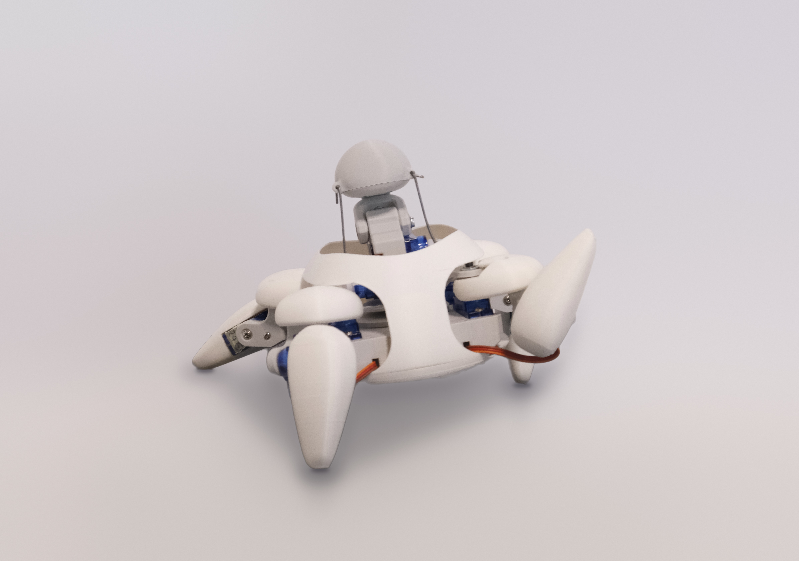
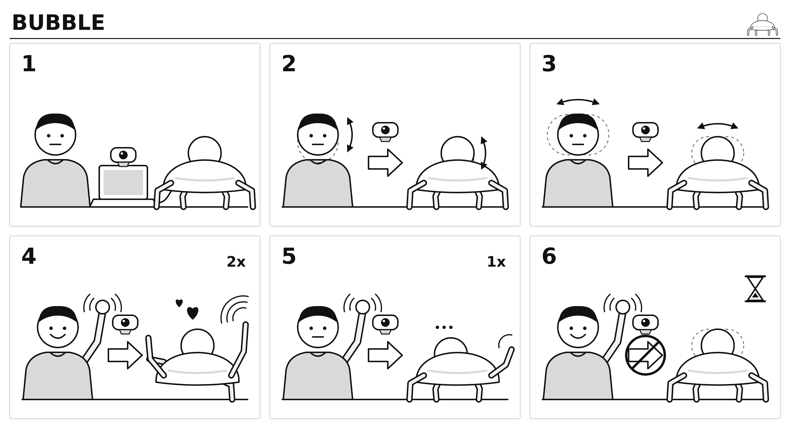
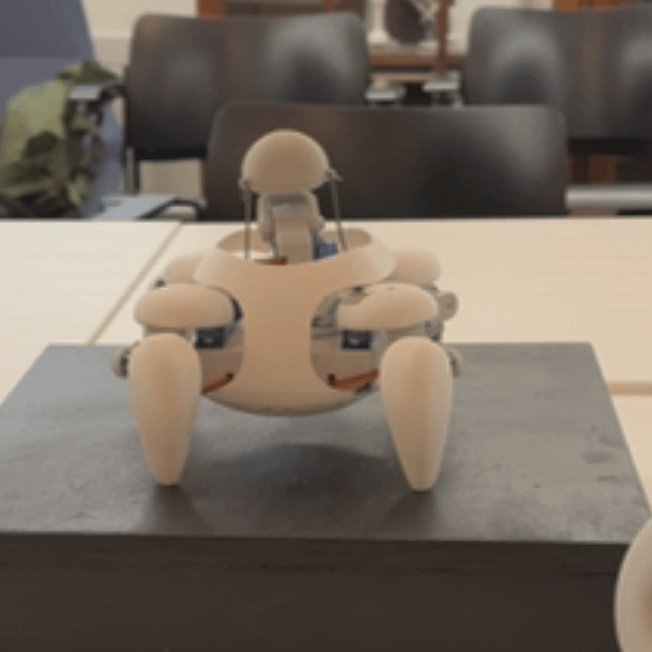
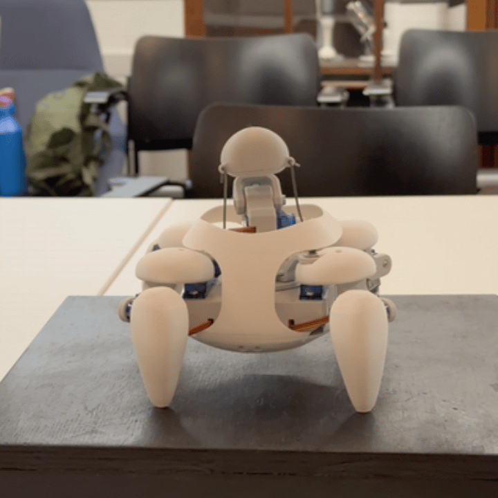
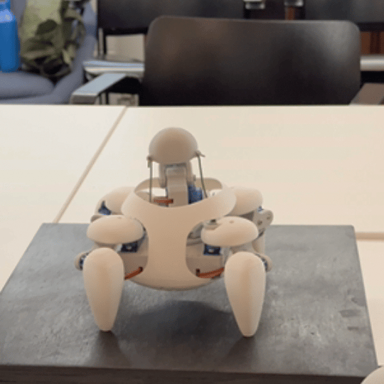
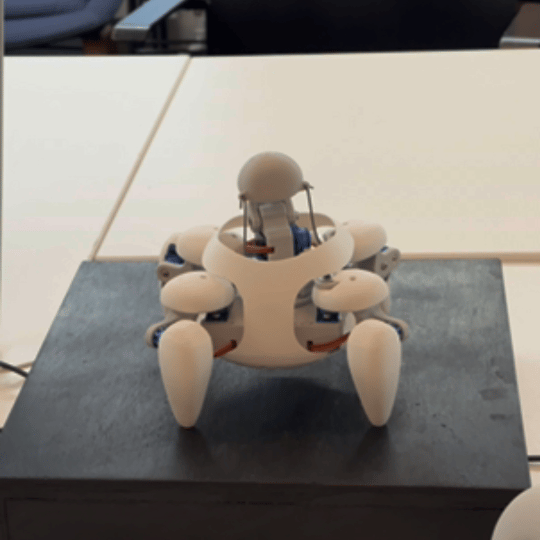
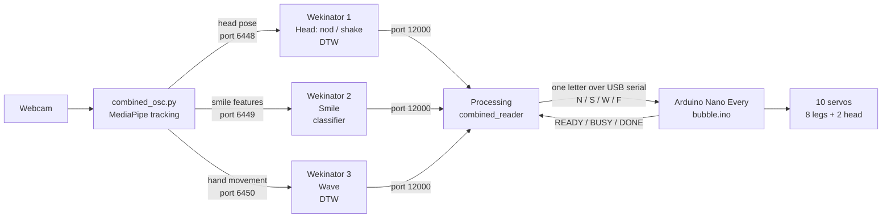
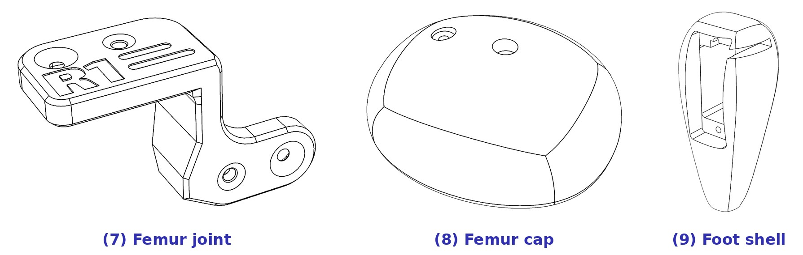
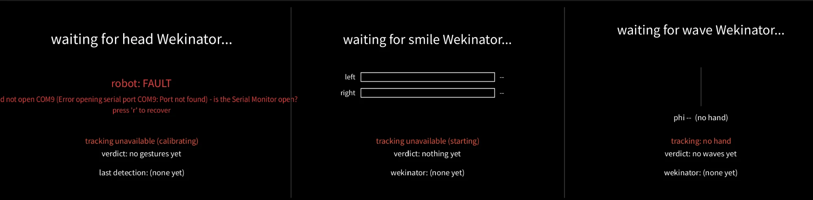

# Bubble-project-documentation-G7

Group Number: 7  
Team Members: Lucie Mallard-Gonder, Rohan Oruganti, Yuying Chen



## Contents

1. [Overall Concept](#overall-concept)
   - [Why These Inputs and Outputs](#why-these-inputs-and-outputs)
   - [User Journey](#user-journey)
2. [System Overview](#system-overview)
3. [Mechanical Design](#mechanical-design)
4. [Hardware Design](#hardware-design)
5. [Assembly Guide](#assembly-guide)
6. [Software](#software)
7. [Machine Learning](#machine-learning-1)
8. [Debugging Guide](#debugging-guide)
9. [Reflection and Future Work](#reflection-and-future-work)
10. [References and Acknowledgements](#references-and-acknowledgements)

All images are in [`images/`](images/).

## Overall Concept
Bubble is a desktop companion that keeps you company while you work. It notices you, reacts to you, and offers a little encouragement, support and entertainment.

Our starting point was Rocky from Project Hail Mary: a character with no face, whose feelings you read entirely from how he moves. Bubble has no face either. Everything it feels, it expresses through posture, movement and timing. A big part of the project was exploring how much emotion a body alone can communicate.

### User Journey



Bubble sits on your desk next to your laptop, connected by USB, while a webcam watches for four everyday gestures. Each one gets its own response, made only with movement: a nod is met with a nod, and a head shake with a sympathetic shake. A wave gets a different reply depending on your expression. If you're smiling, Bubble does a happy little kick and waves back quickly. If you're not, it lowers its head and gives one slow, reluctant wave. After each response, Bubble settles and waits, ignoring new gestures until it has finished moving, so every interaction feels like a short, clear exchange rather than a constant stream of reactions. The illustration below walks through each step, and the GIFs underneath show the real robot in action.

<table>
  <tr>
    <td align="center" width="50%">
      <br>
      <b>You nod → Bubble nods back</b><br>
      <i>Agreement: "I'm with you"</i>
    </td>
    <td align="center" width="50%">
      <br>
      <b>You shake your head → Bubble turns its head from side to side</b><br>
      <i>Sympathy: "no, me neither"</i>
    </td>
  </tr>
  <tr>
    <td align="center" width="50%">
      <br>
      <b>You wave while smiling → Bubble does a happy little kick, then waves back quickly and fluidly</b><br>
      <i>Excitement at seeing you</i>
    </td>
    <td align="center" width="50%">
      <br>
      <b>You wave without smiling → Bubble lowers its head in disappointment, then gives one slow, bouncing wave</b><br>
      <i>A reluctant, sad goodbye</i>
    </td>
  </tr>
</table>

After each response, Bubble settles and waits for the next interaction. It ignores new gestures while it's moving and for a moment afterwards, so it never reacts to its own movement or to a half-finished gesture.

### Why These Inputs and Outputs

We chose inputs that people already use every day to communicate without words: nodding, shaking your head, waving and smiling. They need no explanation or training to use, so anyone who sits down in front of Bubble can interact with it straight away, including people trying it for the first time.

Bubble answers in the same language. It replies to body language with body language, the way a person or a pet would. Smiling on its own doesn't make Bubble move; instead, it changes the meaning of a wave. A happy wave and a reluctant wave get very different responses, which makes the interaction feel personal rather than mechanical.


## System Overview



### Input

A webcam watches the person sitting at the desk. A Python script, `combined_osc.py`, uses **MediaPipe** to track three things at once and sends each to its own Wekinator project:

- **Head:** the head's pitch and yaw (tilting up and down, turning left and right).
- **Smile:** the left and right mouth-smile measurements from the face.
- **Hand:** the hand's movement and tilt.

The script also sends a "tracking status" signal for each, so the rest of the system knows when it can trust the data, for example when a face or hand has gone out of view.

### Machine Learning

Three Wekinator models run in parallel:

| Model | Type | Detects |
| --- | --- | --- |
| 1. Head | Dynamic time warping (DTW) | A **nod** or a **head shake** |
| 2. Smile | Classifier | **Smiling** or **straight-faced** |
| 3. Wave | Dynamic time warping (DTW) | A **hand wave** |

DTW suits nods, shakes and waves because they're movements over time rather than held poses. A classifier suits smiling, which is a state at a single moment.

Full details of the training data and evaluation are in [Machine Learning](#machine-learning-1).

### Messaging

All three Wekinator models send their results to one **Processing** sketch on port 12000, which decides what the robot should do:

- **Nod** or **shake** → sends **N** or **S**.
- **Wave** → Processing checks the person's expression over the next 0.6 seconds. If at least 80% of the smile predictions agree, it sends **W** (smiling) or **F** (not smiling). If the result is unclear, it does nothing rather than guess.

Processing only accepts a gesture when tracking is stable and the robot is free. It sends **one letter** over USB serial, and the Arduino replies:

- **BUSY** when it starts the movement
- **DONE** when it finishes

If the Arduino doesn't reply in time, Processing goes into a safe **fault** state instead of sending more commands. Pressing **r** recovers it.

### Output

The Arduino Nano Every runs `bubble.ino`, which turns each letter into a movement of the 10 servos: 8 in the legs and 2 in the head.

It uses the **ServoEasing** library, so the servos speed up and slow down along curves (linear, bounce, and so on) instead of moving at one fixed speed. We used different curves to give each response its own character, for example a quick, fluid linear wave for happy, and a bounce for the reluctant wave.

**Power:** the servos are powered from the power board,

## Mechanical Design

Bubble Robot is a small four-legged companion that reacts to people with its body and a nodding, tilting and turning head.

We built it on the open-source Sesame quadruped. Sesame can walk and pose, but it has no head; its face is a flat screen. Our goal was a robot whose reactions read clearly across a table. So we added a moving physical head and wrapped the whole robot in a soft, rounded "bubble" body, and we did both without giving up any leg motion.

### What we improved

| | Original Sesame | Bubble Robot |
| --- | --- | --- |
| Servos | 8 (legs) | 10 (8 legs + 2 head) |
| Head | Flat face screen, no head motion | Physical head that nods, tilts and turns |
| Head turn | – | Driven by the L1 hip through a lever; no extra servo; self-centring |
| Leg range | Full | Full: hips keep their original range, knees still turn 180° |
| Body | Open printed frame, servos exposed | Closed rounded shell, cut away around every joint |
| Parts | 3D-printed parts, M2 screws | 3D-printed parts, standard bearings, steel push rods, M2/M3 screws |

### Base Design

We started from the open-source [Sesame robot](https://github.com/dorianborian/sesame-robot) by Dorian Todd. Sesame is a small quadruped with two SG90 servos per leg:

- a **hip servo**, which swings the leg forwards and backwards;
- a **knee servo**, which lifts the foot.

We chose Sesame because its legs already give a stable, posable base that is cheap to print and runs on SG90s. That let us spend our time on the head and the body. We kept its leg layout, servo pockets and joint geometry, and changed everything above the legs.


### Modifications


Every change we made to Sesame, and why we made it.

#### 1. Head sunk into a wider body

**What:** We removed Sesame's screen top and widened the body base. We moved the four hip servos outwards and cut a round opening in the centre for the turntable's bearing hub.

**Why:**
- We wanted Bubble to express emotion and personality without a face. So we removed the screen and let a physical head carry the expression through its posture and movement.
- We widened the base so the head can turn on a turntable inside the body. The legs are unchanged.

#### 2. A 2-servo head that nods and tilts

**What:** Two SG90s sit in a servo hub under the head. They drive it through two steel push rods (see *How the Joints Work*).

**Why:**
- The servos stay low and out of sight, and the head itself carries no motors, so it stays small and light.
- We set the lower servo horn at about 40°, to keep both servos away from their end stops.
- Before printing, we checked every pose in a custom servo simulator. The head stays at least 1.6 mm clear of the frame and servos, and the push rods stay 4.6 mm clear of the head.

#### 3. Head turning driven by the L1 hip

**What:** The head unit stands on a turntable. A lever on the L1 hip turns it, and a rubber band brings it back to centre.

**Why:** Turning the head needs no 11th servo. The lever only engages beyond L1's normal range, so the leg can still walk and pose freely.

#### 4. A rounded "bubble" body

**What:** We gave the whole robot a rounded, bubble-like look:
- a rounded top shell and bottom case;
- femur caps over each hip;
- teardrop foot shells over the knees;
- a round head.

**Why:** It gives the soft, cute and friendly character of our concept, and makes the head and body read as one creature. The shell is shaped around the space each servo needs at its motion limits, so it never limits the hips, knees or head.

<details>
<summary><b>Design process: how we got to the final shell and head</b></summary>

1. **First version: fully rounded shells.** We wrapped every part in smooth domes, including a dome over the head. We rejected it for two reasons:
   - The shells blocked the servos' motion.
   - The dome over the head hid the head mechanism, so its movements no longer read clearly.

   

2. **Mapping the motion.** We went back to sketching. On the Sesame body, we mapped the space each servo sweeps through at its motion limits. That gave us the volumes the shell must leave free.

   

3. **Final shell and head.** We designed the final shell around those clearance volumes, so it never limits the hips or knees. For the head, we kept the original head joint and added a round shell above and below it (the head case top and bottom). This keeps the full head motion and makes the head look cohesive with the body.

   

</details>

### How the Joints Work

#### Turntable (head turning)


- **Bearing Hub (1):** Sits in the centre opening of the body base and holds two 619/8-2Z bearings, so the turntable spins with almost no friction.
- **Turntable Axle (2):** Its shaft runs in the bearings. The disc on top carries the head unit and has a slot for the lever. A rubber band loops over the pin on the hub and is trapped under the disc. It acts as a return spring that pulls the turntable back to centre.
- **Head-turn Lever (3):** Fixed under the L1 femur cap, so it swings with the L1 hip. An MR63 bearing on its peg runs in the slot in the disc. The hip and the turntable turn about different centres, so the slot lets the peg slide in and out as the two arcs meet, and the motion never jams.

How the head turn works:

1. While L1 moves within its normal walking and posing range, the leg moves freely.
2. When L1 swings beyond that range, the lever pushes the disc and the head turns with the leg.
3. When the leg comes back into its free range, the rubber band pulls the head back to centre on its own.

This way the head turns only on purpose, and no servo is needed to bring it back.

#### Head (nod and tilt)


- **Head (4):** The head case top, head joint and head case bottom are bolted together with two M2×12 bolts. Two side lugs take the top ends of the push rods.
- **Neck (5):** The head swivels on the neck about an axis tilted 40° from vertical. It runs on a 639ZZ bearing, held by an M3×10 bolt and nut.
- **Servo Hub (6):** Holds both head servos and is bolted to the turntable. The neck pivots on it about a horizontal axis: an M3×25 bolt through two 639ZZ bearings. This is the nod axis.
- **Push Rods:** Bent from Ø1.2 mm steel wire. Each rod links one servo horn to one side of the head. The left rod is 48.6 mm and the right rod 44.6 mm, measured along the wire.


The two head servos work as a pair:

- When they turn in **opposite directions**, one side of the head is pulled down and the other pushed up, so the head **nods**: about ±22° for ±35° of servo travel.
- When they turn in the **same direction**, the head **tilts** sideways about the 40° neck axis: about +16° / −24°.
- Mixing the two gives in-between poses.


S1 is the upper head servo (HU) and S2 the lower one (HL). Both are at 90° in the centre pose.

#### Legs



- **Femur Joint (7):** Screws onto the hip servo horn and carries the knee servo. Each one has its leg name (L1, L2, R1, R2) embossed on top, so legs cannot be mixed up.
- **Femur Cap (8):** Covers the top of the hip joint and gives it the round look. On L1 it also holds the head-turn lever.
- **Foot Shell (9):** Holds the knee servo inside. Its tapered tip is the only part touching the ground.

### Materials and Fabrication

- **Printed parts:** All custom parts are FDM 3D printed in PLA: white for the body and shell, grey for the head mechanism.
  - Settings: 2 wall loops, 5–10% infill, supports on.
  - The low infill keeps the robot light for the SG90s, and the two walls keep the screw bosses strong.
- **Bearings:** We used off-the-shelf bearings at every rotating joint that carries load :
  - 2 × 619/8-2Z for the turntable;
  - 3 × 639ZZ for the nod and swivel axes;
  - 1 × MR63 for the lever peg.
- **Push rods:** Ø1.2 mm steel wire, bent by hand from a 1:1 template. Steel is stiff enough not to buckle, yet thin enough to hook straight through the servo horn and the head lugs.
- **Fasteners:** M2 screws for servos and printed parts; M3 bolts on the head pivots.
- **Assembly:** The step-by-step construction is in the [Assembly Guide](Build%20resource/Bubble%20Robot%20Assembly%20Guide.pdf). The STL files for every printed part are in [`Build resource/Printing parts`](Build%20resource/Printing%20parts).

### Key Poses

Every movement the robot plays is built from a few poses, set as servo angles in [`bubble_movements.h`](software/arduino/bubble/bubble_movements.h). Servo names follow the leg labels: L1, L2, R1 and R2 are the hips; L3, L4, R3 and R4 are the knees; HU and HL are the upper and lower head servos.


| Pose | Servo angles (°) | What happens |
| --- | --- | --- |
| **Stand** (home) | Hips R1 135, R2 45, L1 45, L2 135 · Knees R3 180, R4 0, L3 0, L4 180 | All four legs straight down. Every gesture starts and ends here. |
| **Nod** | Head rest: HU 70, HL 120. Then 4 times: HU 120 / HL 60 ↔ HU 60 / HL 120 | The two head servos swing in opposite directions, so the head nods "yes". |
| **Shake** | L1 sweeps 45 → 0 → 135 → 0 → 45 | L1 swings past its free range, so the lever turns the head left and right ("no"). The rubber band re-centres it. |
| **Cute** | Hips L1 0, R1 180, L2 160, R2 20 · Knees L3 180, R3 0, R4 180, L4 0. Then 3 times: R4 165 / L4 90 ↔ R4 90 / L4 15 | The legs fold out and two knees wiggle, like a happy little dance. |
| **Wave** | R4 80, L3 150, L2 70, R1 100 shift the weight. Then L3 waves 180 ↔ 100, twice | The robot leans onto three legs and waves the L3 leg. |
| **Disappointed** | Head HU 90 → 12 → 180, then HL 90 → 0 | The head drops down and away. Reset: HU 90, then HL 90. |

These poses are combined into the four movements the robot reacts with:

- **N** → Nod
- **S** → Shake
- **W** → Cute, then Wave
- **F** → Disappointed, then Wave

The Machine Learning section explains which interaction triggers each one.

## Hardware Design

### Wiring


### Schematic


| Servo | Joint | Arduino Nano Every pin |
|---|---|---|
| S1 | L1 | D11 |
| S2 | L2 | D10 |
| S3 | L3 | D12 |
| S4 | L4 | D9 |
| S5 | R1 | D7 |
| S6 | R2 | D6 |
| S7 | R3 | D8 |
| S8 | R4 | D5 |
| S9 | Head, upper servo | D4 |
| S10 | Head, lower servo | D3 |

**Power**
- All 10 servos run from a 5 V rail: power bank → breadboard power board → servo red wires.
- C1 (100 µF / 50 V electrolytic) sits across the 5 V rail and GND to smooth the current spikes when servos start moving (+ leg to 5 V).
- The Nano Every is powered by the computer over USB; the same USB link carries the serial commands from Processing (Wekinator → Processing → Arduino).
- The servo 5 V rail is **not** connected to the Nano's 5V pin. The grounds **are** connected (power board GND ↔ Nano GND), otherwise the servo signals have no reference.

## Assembly Guide

The step-by-step build is in [Bubble Robot Assembly Guide.pdf](Build%20resource/Bubble%20Robot%20Assembly%20Guide.pdf).

Everything you need to build it is in [`Build resource/`](Build%20resource/):

- the STL files for every printed part in [`Printing parts/`](Build%20resource/Printing%20parts/);
- the full CAD model, [`Bubble_robot_CAD.step`](Build%20resource/Bubble_robot_CAD.step);
- the bill of materials, [`Bubble robot-BoM.xlsx`](Build%20resource/Bubble%20robot-BoM.xlsx).

## Software

All of the code is in [`software/`](software/). This section explains how it works and why we built it this way. The step-by-step setup, the Wekinator settings and the test sketches are in [`software/README.md`](software/README.md).

### Repository structure

```
Bubble-project-documentation-G7/
├── README.md            this document
├── images/              figures used in this README
├── Build resource/      CAD (STEP), 3D-print files (STL), bill of materials, assembly guide
├── hardware/            wiring diagram and schematic (KiCad file + images)
└── software/            all the code; setup guide in software/README.md
    ├── python/          camera tracking -> OSC (combined_osc.py and the three pipelines)
    ├── processing/      main Processing sketch (combined_reader)
    ├── arduino/         robot firmware (bubble.ino + bubble_movements.h)
    ├── wekinator/       trained Wekinator projects
    └── tests/           single-pipeline test sketches
```

### Main sketch

The system runs as a chain of four programs, shown in the diagram in [System Overview](#system-overview). Each program only talks to the next one in the chain.

**`combined_osc.py` (Python).** This script opens the webcam once and sends every frame to two MediaPipe models:
- The **Face Landmarker** feeds both the head pipeline and the smile pipeline.
- The **Hand Landmarker** feeds the wave pipeline.

Each pipeline cleans its features (see [Machine Learning](#machine-learning-1)). A sender thread then passes the latest values to that pipeline's own Wekinator at a roughly fixed rate. Each pipeline also sends a tracking-status heartbeat to Processing about whether its signal can be trusted: tracking, holding, lost, calibrating and so on. We first built the three pipelines as separate scripts and merged them into one later (see [Test sketches](#test-sketches)). `combined_osc.py` imports the three single-pipeline scripts, so all four must stay in the same folder.

**`combined_reader` (Processing).** This sketch turns the three Wekinator outputs into **one** robot action. Its tabs are:

| Tab | Job |
|---|---|
| `combined_reader.pde` | Setup and drawing. Routes each incoming OSC message by its address |
| `head.pde` | Nod/shake detections, plus the serial link and robot state machine |
| `smile.pde` | Records smile classifier predictions and checks smile tracking |
| `wave.pde` | Wave detections and wave tracking checks |
| `interaction.pde` | Shared interaction state, expression assessment and the command table |

The interaction rules:

| User does | Robot command | Robot behaviour |
|---|---|---|
| Nods | `N` | Nods back |
| Shakes head | `S` | Shakes its head |
| Waves **while smiling** | `W` | A "cute" pose, then a wave: *hello* |
| Waves **without smiling** | `F` | A "disappointed" pose, then a wave: *goodbye* |

Waving with a smile is how people say hello when they walk into a room, so Bubble replies with a cute wave. Waving without a smile usually happens when someone is leaving, so Bubble looks disappointed.

A smile on its own never triggers anything. A wave starts a **600 ms expression assessment**:
1. The sketch collects the smile predictions that arrive after the wave.
2. It then sends `W` or `F` only if there were at least 5 predictions, at least 80% of them agree, and smile tracking stayed valid the whole time.

Missing or uncertain data never counts as "not smiling"; the assessment is cancelled instead.

Every detection must also pass these checks, or it is **ignored and logged (never queued)**:
- **Tracking:** the Python heartbeat is fresh, and tracking has been clean for 1 s.
- **Interaction:** no expression assessment is running, the robot is `READY`, and the 1 s settle time after the last action has passed. The settle time reduces the chance that leftover movement in Wekinator's DTW window triggers a second action. It doesn't rule it out, because the recorded head gestures are 1.35–2.0 s long, which is longer than the settle time.

The sketch sends each command as one character over serial (115200 baud) and follows the Arduino's replies:

```
NOT_READY --READY--> READY --command--> AWAIT_ACK --BUSY--> BUSY --DONE--> READY
```

The robot goes to `FAULT` if any of these happen:
- no `BUSY` within 1 s
- no `DONE` within 10 s
- the port disconnects
- the Arduino resets mid-gesture

Nothing is retried automatically. Press `r` to recover. Setting `ROBOT_ENABLED = false` runs the whole pipeline without opening the serial port.


*The `combined_reader` window. There is one panel per pipeline: head, smile and wave. Each panel shows its tracking state, its verdict and the last Wekinator output. Here no Wekinator is running yet, and the robot is in FAULT because COM9 was not found (see [Debugging Guide](#debugging-guide)).*

**`bubble.ino` + `bubble_movements.h` (Arduino).** This firmware runs on an Arduino Nano Every and drives the 10 servos with the ServoEasing library. It is adapted from the [Sesame robot](https://github.com/dorianborian/sesame-robot) firmware.
- `bubble_movements.h` holds the poses and the four gestures. Each gesture sets its own easing curves and speeds.
- `bubble.ino` handles the serial protocol. It prints `READY` when idle, `BUSY` when a command is accepted, and `DONE` when the whole gesture has finished. Commands that arrive while it's busy are thrown away, never queued.
- The built-in LED blinks 1–4 times to show which gesture is playing.

### Running the system

**Install:**
- **Python 3.14:** `pip install -r software/python/requirements.txt`
- **Processing 4.5.7:** the **oscP5** library
- **Arduino IDE 2.3.10:** the **ServoEasing** library, with the board set to Arduino Nano Every

**Start in this order:**
1. **Arduino:** upload `software/arduino/bubble/bubble.ino`, then close the Serial Monitor.
2. **Wekinator:** open the three projects in `software/wekinator/` and press **Run** in each.
3. **Python:** run `python software/python/combined_osc.py`, pick the camera, then look straight ahead for about 1 s so it can calibrate the head neutral.
4. **Processing:** open `software/processing/combined_reader/combined_reader.pde`, set `SERIAL_PORT` in `head.pde` to your Arduino's port, then run it.

All three panels should show "tracking", and the robot line should show `READY`. The full setup is in [`software/README.md`](software/README.md#running): camera options, keys, Wekinator settings and wave calibration.

### Test sketches

We built and tested each input as its own pipeline before merging them into `combined_osc.py` and `combined_reader`. Each Python pipeline script still runs on its own, and each one has a small Processing reader, so you can test one gesture by itself. There is also an OSC monitor, which shows exactly what Wekinator sends. The full list, and how to run each one, is in [`software/README.md`](software/README.md#test-sketches).

---

## Machine Learning

### Inputs and classes

All three models get their inputs from **MediaPipe** landmarks on a single webcam. We spent most of our effort on **preprocessing**, to give Wekinator cleaner, more consistent features.

Preprocessing reduces sensitivity to resting head orientation, image scale and sampling differences. It doesn't guarantee recognition that works for any camera or any user, so calibration and testing are still needed when the setup changes.

| Model | Inputs to Wekinator | Classes / gestures |
|---|---|---|
| #1 Head | 2: **pitch, yaw** (degrees from your neutral pose) | nod, shake |
| #2 Smile | 2: **mouthSmileLeft, mouthSmileRight** (MediaPipe blendshape scores, 0–1) | 1 = smiling, 2 = not smiling |
| #3 Wave | 1: **z1 = φ / σ_φ** (normalised hand tilt) | wave |

**Head preprocessing (`head_pose_osc.py`).** The steps, in order:
1. Pitch and yaw come from MediaPipe's facial transformation matrix.
2. A 5-frame **median filter** removes one-frame spikes. The window is counted in camera frames, so the time it covers depends on the frame rate. For example, it's about 0.17 s at 30 fps and about 0.33 s at 15 fps.
3. The **neutral pose** is subtracted. It's the average of 30 frames taken while the user looks straight ahead at startup. This removes the session's resting head orientation, such as a user sitting slightly turned. It doesn't correct for very different camera angles, for different people, or for tracking errors.
4. An **EMA** (α = 0.4) and a **±5° deadzone** reduce jitter. 
5. The features are sent at about **20 Hz**, using the latest available measurement. Sending at a steady rate isn't the same as getting 20 new measurements a second: if the camera loop runs slower than 20 Hz, values are repeated.

**Tracking loss and reacquisition.** The steps when the face is lost and found again:
1. The last value is held for 0.5 s, then glides back to neutral.
2. When the face comes back, the output moves towards the new value at no more than 3° per send tick (60°/s).
3. Processing ignores head gestures while the status isn't "tracking" (holding, lost or recovering), and for 1 s after tracking becomes clean again.

The recorded head gestures are 1.35–2.0 s long. So Wekinator's DTW window can still contain part of the generated glide after that 1 s. These generated movements can still be mistaken for part of a nod or shake.

**Smile preprocessing (`smile_osc.py`).** The two smile blendshapes are looked up by name and passed through a 5-frame median filter. As with the head pipeline, the time this window covers depends on the camera frame rate. The values are then sent at about 20 Hz, using the latest measurement. Values are only trusted when the face is within 35° of yaw and 30° of pitch, because blendshapes become unreliable when the face is turned further. Beyond that, the status changes to "off angle".

**Wave preprocessing (`wave_osc.py`).** The steps, in order:
1. **Hand selection:** if several hands are visible, it picks the **largest apparent hand**, then follows that hand from frame to frame. It ignores hands smaller than `min_hand_size`. This is a selection heuristic. The largest hand in the image isn't necessarily the closest one, or the person who is interacting.
2. **Tilt angle φ:** the tilt of the hand's axis in the image plane. It's the angle of the line from the wrist to the middle-finger knuckle, measured from the camera's vertical (upright = 0, tilted towards image-right = positive). We assumed a wave usually shows up as φ swinging back and forth around upright. Waving from the wrist and waving from the elbow can produce similar tilt patterns, but aren't guaranteed to. φ doesn't fully describe a wave: a hand that moves sideways while keeping nearly the same tilt barely changes φ. The script has an optional second feature for sideways palm position (`use_x`), but it's off in our configuration.
3. **Clean-up:** it corrects for the frame's aspect ratio and unwraps φ, so the angle never jumps by 360°.
4. **Smoothing:** a **One Euro filter** ([Casiez, Roussel & Vogel, 2012](https://gery.casiez.net/1euro/)) smooths φ. It trades stronger jitter suppression at low speeds against lower lag during faster movement.
5. **Normalisation:** z1 = φ_smoothed / σ_φ, which has no units. No reference or mean angle is subtracted first; φ is used as measured from the camera vertical.
   - **How σ_φ is calculated:** in calibration mode (`--wave-calibrate`, 20 s by default), it's the population standard deviation of the **raw, unfiltered** φ over all frames where a hand was detected, in **radians**. It's stored in `wave_config.json`.
   - **Safety checks:** calibration needs at least 30 hand frames. It is rejected, leaving the config unchanged, if σ_φ comes out below 0.001 rad.
   - **No runtime limit:** there's no lower limit when the config is loaded, so a hand-edited value close to 0 would make the input blow up.
   - The current value, 0.4 rad (about 23°), is the script's default.

6. **No hand, no data:** nothing is sent when no hand is visible. Sending zeros instead would draw fake shapes for DTW to match against. Features are sent at about 30 Hz (`send_hz`), using the latest measurement.

### Outputs and models

We use **three separate Wekinator projects** instead of one. Head and wave are movements over time, so each gets a **Dynamic Time Warping (DTW)** model. Smile is a static expression, so it gets a **classifier**. Separate projects can also be retrained one at a time without affecting the others.

| Project | Listens on | Inputs | Model | Output message (to port 12000) |
|---|---|---|---|---|
| #1 Head | 6448 | 2 | DTW, 2 gestures | `/output_1` = nod, `/output_2` = shake |
| #2 Smile | 6449 | 2 | Classifier, 2 classes | `/smile/outputs`: 1 = smiling, 2 = not smiling |
| #3 Wave | 6450 | 1 | DTW | `/wave/outputs` |


**Why DTW for nod, shake and wave.** A nod is defined by the **shape** of the head's movement over time: down, then back up. DTW compares the recent movement with the recorded examples and lets them stretch or squash in time, so it tolerates some variation in how fast the gesture is done ([tslearn DTW guide](https://tslearn.readthedocs.io/en/stable/user_guide/dtw.html)). How well it copes still depends on the recorded examples and on Wekinator's DTW settings. A classifier only sees one moment at a time. It can't tell a nod from someone who is simply looking down, because a nod only counts once the head comes back up. A wave works the same way: the hand swings back and forth around the upright position, so the pattern over time is what matters. Both could also be recognised by a classifier using features from a short window of movement. We chose DTW because these gestures vary in speed and style between users.

**Why a classifier for smile.** A smile shows up in a single frame: the two corners of the mouth are in a certain position. So a classifier on the two mouth blendshapes is enough. Processing then smooths the classifier's output over the 600 ms expression window described above.

### Training data

The saved Wekinator projects contain:

| Model | Examples |
|---|---|
| Head (DTW) | 10 recorded gestures: 5 nods (1.35–1.70 s each), 5 shakes (1.45–2.00 s each) |
| Smile (classifier) | 356 labelled frames: 209 smiling (4 recording rounds), 147 not smiling (1 round) |
| Wave (DTW) | Not counted. The project isn't on this PC |

We used small example sets while prototyping, and spent most of the effort on preprocessing. We got the final camera late in the project. We haven't formally checked whether these example sets are enough for unfamiliar users or other camera setups.

Training is quick: during the live tutor demo, we retrained the smile model in a few seconds. This is because Wekinator only receives the numeric features we send from MediaPipe, not raw images, so it isn't directly affected by the pixels. However, MediaPipe's tracking accuracy can still vary with lighting, camera angle and appearance, so these factors can still affect the features Wekinator receives.


The preprocessing settings are fixed. They're labelled "LOCKED CONVENTIONS" at the top of each Python file. Changing the number or order of inputs, the units, the send rate, the filter windows or `wave_config.json` makes the recorded examples invalid, and they have to be recorded again.

### Evaluation and Future Work

We haven't run a formal test with counted trials. Informally, all three gestures were recognised fairly reliably during development.

At the **live demo**, visitors were able to trigger the gestures fairly accurately. However, nod and shake produced both false positives and false negatives. They sometimes triggered by accident, and visitors didn't find them the most intuitive gestures to use. We haven't confirmed why. A likely cause is that people move their heads naturally while looking around or talking to each other, and some of those movements are close enough to a nod or shake to match.

The reader's checks are designed to reduce accidental triggers: the tracking-status checks, the 1 s settle time, the 80% smile agreement, and ignoring detections while the robot is busy. We haven't measured how much they reduce them.

Known limitations that a test should cover:
- The median-filter windows cover different lengths of time at different camera frame rates.
- Values are repeated when processing runs slower than the send rate.
- The generated movement during tracking recovery is also sent to Wekinator.
- φ doesn't capture a wave made by moving the hand sideways without tilting it.

Each ignored detection is logged with its reason (`IGNORED nod: ...`). A next step would be to log these over a session, then try 20 attempts per gesture and count hits, misses and false triggers.

The main priority is to reduce accidental triggers without making deliberate gestures harder to recognise. Further development should combine counted evaluation with targeted changes, rather than tuning the system solely around the team’s own movements.

**Calibrate head filtering and dead zones.** The EMA smoothing and dead-zone settings were selected during development rather than systematically calibrated. Future work should measure tracking noise while users sit still, then compare these measurements with small and large deliberate gestures. Testing across several people and camera configurations would help select settings that suppress jitter without rejecting subtle nods or shakes. Evaluation should include people or sessions not used for tuning, to avoid overfitting the settings to the developers.

**Investigate DTW sensitivity.** Nod and shake produced accidental detections during the live demo, but their causes have not been confirmed. Possible contributors include natural head movements resembling the recorded gestures, insufficiently varied examples, preprocessing settings and the DTW matching configuration. Future tests should log pitch/yaw sequences alongside detections and compare false positives and false negatives under controlled changes to the threshold, matching settings and training examples. Our working explanation is that nod and shake recordings share similar stretches: both start and end near neutral, and small pitch and yaw movements appear in both. As a result, short or small head movements can sit close to examples of either gesture. DTW compares whole sequences rather than single positions, so this overlap needs to be confirmed in the logged data rather than assumed.

**Compare alternative temporal recognition methods.** A future comparison could test the current angle-based DTW recogniser against DTW with additional angular-velocity features, or a classifier using features extracted from a short movement window. A classifier using only the current pitch and yaw would not explicitly represent the complete gesture. Any alternative should therefore retain movement history and be evaluated on varied gesture sizes, speeds and users. We would not assume that classification is better without comparing recognition accuracy, latency and accidental-trigger rates.

**Defining a wave.** We currently represent waving through the hand-tilt angle φ. The script also supports adding the palm’s sideways position through the `use_x` option, but we left this disabled. We were concerned that ordinary sideways hand movements could affect matching and introduce accidental detections, and we did not have time to validate the additional feature’s scaling or its effect on recognition. We therefore kept the prototype to the single tilt input that we had tested. This was a conservative implementation choice, not evidence that multiple inputs are inherently less reliable. Future work should compare tilt alone with tilt plus palm position, measuring whether the additional feature supports more waving styles without increasing false detections.

**Improve hand selection and identity tracking.** Selecting the largest apparent hand worked adequately during the live demonstrations, so this is a lower priority than head-recognition reliability. Nevertheless, future testing should include multiple visible hands and people entering or leaving the frame. Alternative selection rules could use handedness, spatial continuity or an explicit user-selection step to reduce unintended switching between hands.

These changes should be assessed using both deliberate gesture trials and timed periods of ordinary behaviour, such as talking, looking around and reaching. Results should distinguish Wekinator detections from robot actions, since the interaction controller intentionally rejects detections while the robot is busy or an expression assessment is running.

---

## Debugging Guide

Start with the **Processing console**. Every detection is printed as `ACCEPTED` or `IGNORED` with a reason. The first time each OSC address arrives, a line like `ADDRESS /smile/outputs -> smile` is printed, so you can see which programs are connected.

| Symptom | Likely cause | Fix |
|---|---|---|
| `robot: FAULT – could not open COM9 (Port not found)` (see screenshot above) | Wrong serial port, or the Arduino isn't plugged in | Set `SERIAL_PORT` in `head.pde` to the port shown under "Serial ports:" in the console, or to `""` to use the last one. Press `r` |
| `could not open COMx ... is the Serial Monitor open?` | The Arduino IDE Serial Monitor has the port open | Close the Serial Monitor. Only one program can use the port |
| Robot stays `NOT READY` | Firmware not uploaded, wrong baud, or a servo pin left unset | Open the Serial Monitor at 115200 and read the `DEBUG:` lines. Any `PIN_` left as `PIN_NOT_SET` stops `READY` |
| `FAULT` straight after a command | The Arduino reset or didn't reply `BUSY` within 1 s | Check the USB cable and power, then press `r` |
| A panel says `waiting for ... Wekinator...` | That Wekinator isn't running, isn't in **Run** mode, or sends to the wrong port or address | Check the [Outputs and models](#outputs-and-models) table. Use the OSC monitor in `software/tests/test_osc/` to see what's actually arriving |
| `ADDRESS /wek/outputs -> UNHANDLED` | A Wekinator output message was left at the default `/wek/outputs` | Rename it to `/smile/outputs` or `/wave/outputs` |
| `tracking unavailable` in every panel | `combined_osc.py` isn't running, so there's no heartbeat | Start the Python script |
| Head: `tracking unavailable (calibrating)` | Neutral calibration is still running, or no face is visible | Look straight at the camera and hold still, or press `c` |
| Smile: `off angle` | Face turned more than 35° (yaw) or 30° (pitch) | Face the camera |
| Wave: `no hand`, or `hands below min_hand_size` in the camera window | Hand not found, or too small in the frame | Move closer, or lower `min_hand_size` in `wave_config.json` (no retraining needed) |
| `Could not open camera N` | Another app is using the webcam | Close it. List cameras with `python combined_osc.py --list` and pick one with `-c N` |
| Wekinator shows no incoming data | Wrong input port or input count | Ports 6448 / 6449 / 6450. Inputs 2 / 2 / 1 (the wave count is printed when the script starts) |
| Port 12000 already in use | Another reader or test sketch is still open | Close it. Only one sketch can listen on 12000 |
| Wave detections stop matching after a settings change | `wave_config.json` or another locked setting was changed | Re-record the Wekinator examples |
| A gesture is detected but nothing happens | It was ignored on purpose: robot busy, assessment running, settle time, or tracking not stable | Read the `IGNORED ...: reason` line in the console |

## Reflection and Future Work

### What Worked

- **Movement carries emotion.** Even without a face, small changes in speed and easing made the same wave read as happy or sad. Using different ServoEasing curves (linear for a fluid, happy wave, bounce for a reluctant one) was one of the simplest and most effective ways to give Bubble character.
- **Running three models in parallel.** Splitting head, smile and wave into separate Wekinator projects, coordinated by one Processing sketch, meant each model could be trained and tested on its own. The same structure can grow to more gestures without retraining everything.
- **Designing the movement digitally first.** We acted the responses out like a puppet, then used a custom head-servo simulator and a digital twin of the robot to design and check the movements before running them on the hardware. This saved time and protected the servos from poses that would have collided.
- **Turning the head without an extra servo.** Driving the head turn from the L1 hip through a lever kept the robot to 10 servos and reduced the load on the power supply.

### Challenges and What We Learned

- **Servos:** five of our servos turned out to be continuous-rotation (360°) instead of 180°, so they couldn't hold a pose. We only found this by testing each servo on its own, which taught us to test every component before building it in.
- **Power:** the Arduino alone couldn't power the two head servos reliably; they lagged and the board overheated. Moving all servo power to the power board fixed this. We also learned to stagger servo start-up to avoid sudden current spikes.
- **Circuit:** our breadboard circuit kept failing, and we eventually rebuilt it from scratch. Several faults came from basic breadboard mistakes, such as power rails that don't connect across separate boards and rows that aren't joined across the centre gap. These are now part of our debugging guide.
- **Head mechanism:** our first head linkage used string, which went slack under gravity. We changed it to a rigid rod and finally to steel wire push rods. A bearing was also modelled at the wrong size at first, so the pedestal had to be redesigned.
- **Shell:** the first shell was too thick and heavy, blocked a leg and hid the head's movement. We remapped the space each joint needs, thinned the walls and redesigned the head as a rounder shape (see [Design process](#mechanical-design)). We tried adding holes to save weight, but felt they took away from Bubble's soft, friendly look.

### Future Work

- **More interactions.** We designed further responses that we didn't have time to build:
    - Tapping the desk (losing focus): a playful, puppy-like pounce.
    - Rubbing your face (tired or stressed): a concerned, side-to-side head movement.
    - Looking directly at it: a shy reaction.
    - Hands together (finished working): a randomly chosen victory dance.
- **Voice.** Audio input, and connecting a language model so Bubble can respond to what you say, which was our original extension.
- **A built-in camera,** so Bubble sees from its own point of view instead of from a separate webcam.
- **Neater wiring.** A servo driver board (PCA9685) would reduce the cables coming out of the body to four, making the robot tidier and easier to move.
- **Testing with users,** to find out which movements people read as which emotions, and refining them from that.

## References and Acknowledgements

### Design and Hardware

- **Sesame robot** by Dorian Todd (dorianborian): the base quadruped design, printed leg parts, pose angles and original firmware. https://github.com/dorianborian/sesame-robot (Apache 2.0 licence)
- **CPS module resources** (Imperial College London / RCA): robot arm, build resources and example code. https://github.com/IDE-GID-Cyberphysical-Systems

### Software and Libraries

- **Wekinator** by Rebecca Fiebrink: interactive machine learning. http://www.wekinator.org
- **MediaPipe** by Google, including the Face Landmarker and Hand Landmarker models: face, head and hand tracking. https://ai.google.dev/edge/mediapipe
- **OpenCV** (`opencv-python`): webcam capture. https://opencv.org
- **NumPy:** numerical processing. https://numpy.org
- **python-osc:** sending OSC messages from Python to Wekinator. https://pypi.org/project/python-osc/
- **Processing:** https://processing.org
- **oscP5** by Andreas Schlegel: receiving OSC in Processing. https://sojamo.de/libraries/oscP5/
- **Arduino IDE:** https://www.arduino.cc
- **ServoEasing** by Armin Joachimsmeyer: smooth, eased servo movement on the Arduino. https://github.com/ArminJo/ServoEasing

### Acknowledgements

Thank you to the CPS teaching team, Becky Stewart, Oisin Shaw and Andy Brand, and to the teaching assistants, PHD students Imogen Young, Wei Zhang and IDE 2 student Carl, for their guidance and feedback throughout the project. Thank you to the ACE Workshop technicians for their help with fabrication and 3D printing, and to our classmates for their help troubleshooting along the way.

### Use of Generative AI

In line with the module guidance, we declare the following use of generative AI tools:

- **Claude (Anthropic):**
    - adapting the Sesame firmware to the Arduino Nano Every and our wiring
    - writing hardware test and calibration sketches
    - troubleshooting the circuit and power set-up
    - building the head-servo animation simulator and robot digital twin for animation.
    - help structuring and drafting parts of this documentation
- **Perplexity:** generating an overview of the system architecture.

All AI-assisted code was tested on our hardware and reviewed by the team. All design decisions, and the final content of this documentation, are our own.
