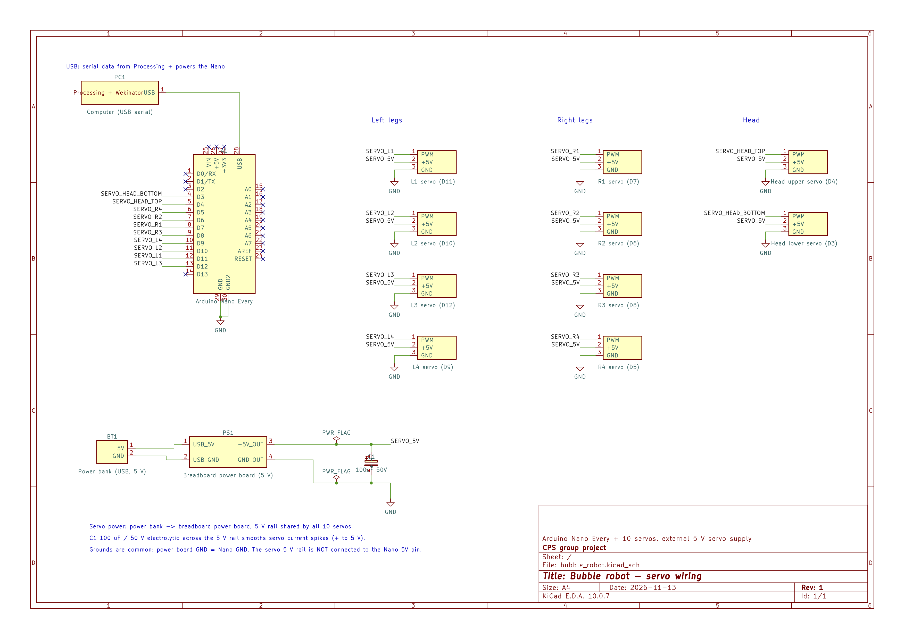

# Wiring

## Schematic

| Servo | Joint | Arduino Nano Every pin |
|---|---|---|
| M1 | L1 | D11 |
| M2 | L2 | D10 |
| M3 | L3 | D12 |
| M4 | L4 | D9 |
| M5 | R1 | D7 |
| M6 | R2 | D6 |
| M7 | R3 | D8 |
| M8 | R4 | D5 |
| M9 | Head, upper servo | D4 |
| M10 | Head, lower servo | D3 |

**Power**
- All 10 servos run from a 5 V rail: power bank → breadboard power board → servo red wires.
- C1 (100 µF / 50 V electrolytic) sits across the 5 V rail and GND to smooth the current spikes when servos start moving (+ leg to 5 V).
- The Nano Every is powered by the computer over USB; the same USB link carries the serial commands from Processing (Wekinator → Processing → Arduino).
- The servo 5 V rail is **not** connected to the Nano's 5V pin. The grounds **are** connected (power board GND ↔ Nano GND), otherwise the servo signals have no reference.
